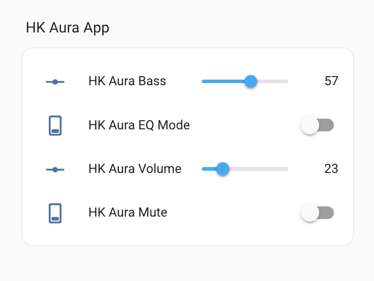

# HK Aura Plus Speaker Home Assistant Integration

[](https://github.com/hacs/integration)

A custom Home Assistant integration for controlling the Harman Kardon Aura Plus speaker over your local network. Provides Home Assistant entities for volume, bass, EQ mode, mute, and power control.

## Features

- **Volume Control** — Adjust speaker volume (0–100)
- **Bass Control** — Fine-tune bass level (0–100)
- **EQ Mode** — Toggle between Basic and Stereo Widening
- **Mute/Unmute** — Toggle switch
- **Power Off** — Turn off speaker via button
- **Volume Sync** — Optionally sync with a media_player entity
- **Bluetooth wake & state (optional, experimental)** — wake the speaker from standby, read its power state and pick its input over Bluetooth Classic (RFCOMM), with no audio stream needed
- Seamless integration with Home Assistant UI and automations

> **⚠️ Note**: The power-off button fully shuts down the speaker. To turn it back on, use the physical power button, the official HK Remote app, or the [Bluetooth wake](#bluetooth-wake-and-state-optional) feature below.

## Requirements

- Home Assistant 2024.11.0 or newer
- Harman Kardon Aura Plus speaker connected to your local network

## Installation

### HACS (Recommended)

1. Open HACS in Home Assistant.
2. Go to **Integrations** → click the **⋮** menu (top right) → **Custom repositories**.
3. Add `https://github.com/vakintosh/harman_kardon_aura_HA` with category **Integration**.
4. Search for **HK Aura Plus Speaker** and install.
5. Restart Home Assistant.

### Manual

1. **Clone or download** this repository.
2. **Copy** the `custom_components/hkaura_plus/` directory to your Home Assistant `custom_components/` folder.
3. **Restart** Home Assistant.

## Configuration

This integration is configured via the UI:

1. Go to **Settings → Devices & Services → Add Integration**.
2. Search for **HK Aura Plus**.
3. Enter your speaker's IP address and port.


### Configuration Options

| Option | Required | Description |
|--------|----------|-------------|
| Host | Yes | IP address or hostname of your HK Aura Plus speaker |
| Port | Yes | Port number for communication (default: 10025) |
| Media Player Entity | No | Entity ID of a media player to sync volume with |
| Bluetooth MAC | No | Speaker's Bluetooth address, e.g. `B8:69:C2:15:29:FD`. Enables the Bluetooth features below |
| Wake wait | No | Seconds to wait for the Wi-Fi port after a wake (default 120; boot to a usable Wi-Fi port took 25-60 s in testing) |

### Volume Sync

If you configure `media_player_entity` (e.g., `media_player.hk_aura_airplay` from Music Assistant), volume changes on the media player will automatically be sent to the physical speaker. This keeps the speaker volume in sync regardless of how you control it.

## Usage

After configuration and restart, the following entities appear in Home Assistant:

| Entity | Description |
|--------|-------------|
| `number.hk_aura_volume` | Volume control (0–100) |
| `number.hk_aura_bass` | Bass level (0–100) |
| `switch.hk_aura_eq_mode` | EQ mode toggle |
| `switch.hk_aura_mute` | Mute toggle |
| `button.hk_aura_power_off` | Power off button |
| `binary_sensor.hk_aura_power` | On/off, read over Bluetooth (works in standby) — *Bluetooth only* |
| `button.hk_aura_power_on_wake` | Wake from standby — *Bluetooth only* |
| `select.hk_aura_source` | AirPlay / Bluetooth / AUX / Optical — *Bluetooth only* |

## Dashboard



<details>
<summary>Lovelace YAML</summary>

```yaml
type: grid
cards:
  - type: heading
    heading_style: title
    heading: HK Aura App
  - type: entities
    entities:
      - entity: number.hk_aura_volume
      - entity: number.hk_aura_bass
      - entity: switch.hk_aura_eq_mode
      - entity: switch.hk_aura_mute
      - entity: button.hk_aura_power_off
```

</details>

## Bluetooth wake and state (optional)

The speaker keeps a Bluetooth Classic serial (RFCOMM, SPP) control channel open
even in standby, while its Wi-Fi is off. The integration uses it to read power
state and to send the wake command, so no audio stream is needed.

**Requirements**

- The machine running Home Assistant needs its **own Bluetooth adapter** with BlueZ (Linux). ESPHome/BLE
  proxies **cannot** be used: they relay Bluetooth Low Energy only, and this channel is Classic.
- The speaker must be **paired** with that machine (`bluetoothctl pair <MAC>`; connecting once also pairs it on a Raspberry Pi).
- Home Assistant must be allowed to open Bluetooth sockets. A Home Assistant container on a Raspberry Pi
  with `hostNetwork` and the `NET_ADMIN` capability worked. HA OS, Supervised and VM installs are **untested**.

Enter the speaker's Bluetooth MAC when adding or reconfiguring the integration. If this machine cannot use
RFCOMM, the form says so and you can continue with Wi-Fi only; the Wi-Fi entities never depend on Bluetooth.

**Wake service**

```yaml
action: hkaura_plus.wake
data:
  timeout: 60   # optional, seconds to wait for the Wi-Fi port
```

The power command the speaker understands is a toggle (the same bytes switch it on and off). The integration therefore
reads the power state first and sends it **at most once, and only when the speaker reads as standby**. If the speaker is
already on, nothing is sent. The call returns once the Wi-Fi control port is open, so a following AirPlay/Music Assistant
play command is safe.

**Good to know**

- The first connection after a long idle can take several seconds, and 25-60 s before the Wi-Fi port is back.
- State is polled over Bluetooth every 60 s using short-lived connections.
- Only one speaker/firmware (Aura Plus, FW 2.0.1) has been verified.
- The legacy A2DP scripts in [`scripts/`](scripts/) still work but are no longer needed.
- Protocol details were derived from the official app; see `scripts/hk_rfcomm_probe.py` for a read-only probe you can run to check your speaker.

## Project Structure

```
├── custom_components/
│   └── hkaura_plus/      # Home Assistant custom component
├── scripts/              # Legacy wake scripts, read-only RFCOMM probe
├── tests/                # Unit tests; tests/live needs a real speaker
└── img/                  # Screenshots
```

## How It Works

The speaker exposes a TCP control port (default 10025) that accepts XML commands. The integration sends XML payloads over raw TCP — no HTTP framing is used. The speaker processes the command and optionally returns a status XML response.

## Troubleshooting

- Ensure your speaker is on the same network as Home Assistant.
- Check the IP address in your configuration.
- Review Home Assistant logs for integration errors.

## Disclaimer

This integration is not affiliated with or endorsed by Harman Kardon.

## License

MIT — see [LICENSE](LICENSE) for details.